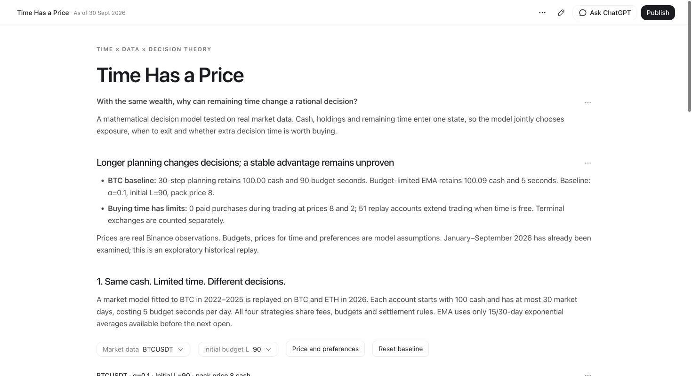

# Time Has a Price

**When is waiting worth its cost?**

A personal side project for experimenting with time budgets and trading decisions.
Using real Bitcoin and Ethereum prices, it compares a full 30-step planner,
a two-step planner and public moving-average signals under the same costs.



## Run the interactive report

Python 3 is enough to display the report. No package installation, exchange
account, API key or internet connection is needed after downloading the project.

```bash
git clone https://github.com/Wanji-Jimmy/time-has-a-price.git
cd time-has-a-price
python3 serve.py --open
```

The command opens a browser on a free local port. Keep the terminal running.
On macOS, you can also double-click `RUN_DEMO.command`. In VS Code, open this
folder and choose **Tasks: Run Task → Start Time Has a Price**.

Start with **Reset baseline**, compare cash with remaining budget, then click
**Show a changed decision**. Open **Methods and checks** for the mathematics,
uncertainty and verification. The report displays completed experiments;
starting the server does not rerun the backtest.

## The model

An account starts with 100 cash. Each market day consumes five budget seconds.
A time pack adds 15 seconds, with at most six packs available. The controller
can exit, continue with 0%, 50% or 100% invested, or buy a pack before choosing
one of those exposures: seven actions in total.

The terminal objective values settled cash $B$ and remaining budget $L$:

$$U(B,L)=(1-\alpha)\ln(1+B/100)+\alpha\ln(1+L/90).$$

These time units, prices and preferences are explicit modeling assumptions,
not measured human lifespan. Exit includes an optional final cash-for-time
exchange, consistently available to all constrained controllers. We report
those exchanges separately from purchases that extend trading.

The planner uses finite-horizon Bellman recursion. It takes expectations
before choosing an action; future decisions react only after new information
arrives. Reachable resource and portfolio nodes merge, while wealth uses
linear interpolation. This is an approximate solution of an empirical model,
not an exact optimum for continuous real markets.

## Data and results

The market kernel uses BTC daily data from 2022–2025 and remains frozen.
Historical replay uses BTC and ETH from January–September 2026: 24 fixed
settings, 213 overlapping starts per asset and six controllers, totaling
**61,344 episodes**. We had already inspected 2026 prices, so this is historical
re-evaluation rather than a blind test.

At the BTC baseline—pack price 8, time preference 0.1 and initial budget 90:

| Strategy | Final cash | Budget seconds left |
| --- | ---: | ---: |
| 30-step planner | 100.00 | 90.00 |
| 2-step planner | 100.00 | 90.00 |
| Budget-limited EMA | 100.09 | 5.00 |
| EMA with mechanical purchases | 85.34 | 8.05 |

These are means across overlapping episodes, not a continuous account's
annual return. Trading fees and time purchases both affect final cash.

Longer planning changes **6 of 192** fixed initial decisions. In the displayed
45-second example, two steps choose exit while 30 steps choose full investment.
The corresponding BTC historical utility difference is **−0.000708**, with a
30-day block 95% interval of **[−0.003254, +0.001074]**. The interval includes zero;
we have not established a stable improvement.

The 30-step planner makes no purchases during trading at either paid price
tested, 8 or 2. Free time produces 65 purchases in 51 overlapping accounts.
At the main setting, our 30-step optimizer chooses to leave.

## Verify or reproduce the numerical experiment

The numerical tools require NumPy; the report server does not.

```bash
python3 -m pip install -r requirements.txt
python3 -m unittest discover -s long_horizon_v3 -p 'test_long_planner.py' -v
python3 long_horizon_v3/verify.py
```

The saved replay passes 12 synthetic tests and a separate audit of **391,772
ledger events**. Verification uses the included data and ledgers. To recompute
the experiment rather than inspect its saved outputs, see
[the model guide](long_horizon_v3/README.txt).

## Repository contents

- `demo/`: self-contained interactive report.
- `long_horizon_v3/`: planner, experiments, tests, saved results and ledgers.
- `time_budget_policy_v2/`: frozen earlier engine/kernel and 2026 market prices.
- `real_market_four_stage/data/`: 2022–2025 training prices.
- `moving_average_life_compare/`: original EMA baseline.
- `presentation_source/`: authored report React and CSS; rebuilding these
  files requires the Codex Data report renderer. The exported demo runs alone.
- `submission_docs/BROWSER_DEMO_SCRIPT_EN.txt`: brief browser demonstration.
- `presentation/`: optional slide backups; slides are not required for the demo.

## Sources and attribution

Market observations come from [Binance public data](https://github.com/binance/binance-public-data).
The EMA signal adapts the public [QuantConnect LEAN moving-average example](https://github.com/QuantConnect/Lean/blob/979bd9baef79206b21de257f52601be28d5ab767/Algorithm.Python/MovingAverageCrossAlgorithm.py).
No historical profitability claim transfers from that source to this project.

We used AI assistance for coding, analysis and interface production. The report
uses the Codex Data renderer and requires no live language-model service.
Third-party dependency notices are included in `THIRD_PARTY_NOTICES.txt`.

The next evaluation should freeze the rules and use genuinely unseen data,
alternative market models and sensitivity checks on the utility assumptions.
